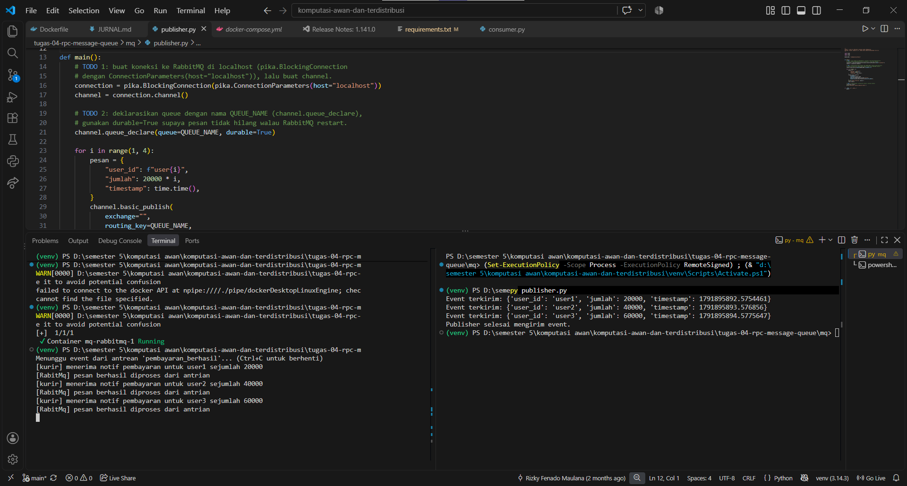
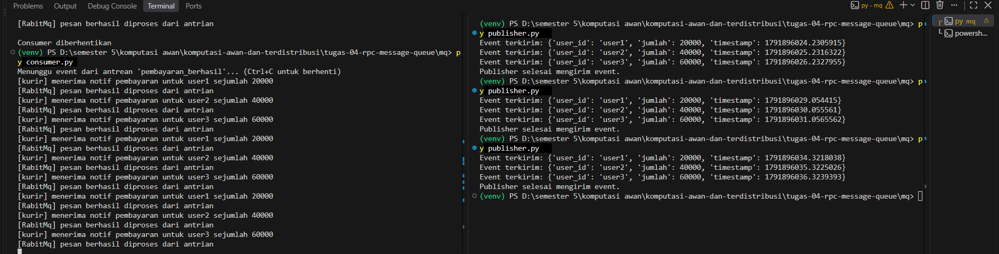

# Jurnal Proses — Tugas 4

## Jalur yang dipilih
- [RPC / MQ / keduanya], alasan: Message Queue (MQ) dengan RabbitMQ, karena lebih cocok digunakan. Jadi, modul pembayaran bisa mengirim informasi pembayaran berhasil tanpa harus menunggu respon dari modul kurir atau notifikasi. Kalau misal modul kurir sedang bermasalah maka pesan akan tetap menunggu di antrean dan akan diproses saat modul aktif lagi. Sehingga pengiriman informasi pembayaran tidak akan terhambat hanya karena modul kurirnya bermasalah. Kalau pakai RPC modul pembayaran harus menunggu respon dulu dari modul kurir yang nanti pasti akan membuat proses jadi lebih lambat kalau ada masalah. Oleh karena itu, kami memilih MQ dan tidak memilih RPC.

## Kendala teknis
- Error saat setup (mis. koneksi RabbitMQ ditolak, port bentrok): ...

## Uji "pesan tidak hilang" (khusus Jalur B)
### Bukti 1

Gambar diatas merupakan percobaan pertama untuk consumer.py dan publisher.py terlihat bahwa hasil dari keduanya sudah sesuai

### Bukti 2

- Langkah uji: matikan consumer → jalankan publisher → nyalakan consumer
- Hasil yang diamati: Saat consumer.py dimatikan, publisher.py berhasil mengirimkan tiga pesan setiap kali dijalankan. Saat consumer.py udah dinyalakan lagi pesan-pesannya diterima dan diproses yang menunjukkan kalau pesan tersimpan sementara di antrean meskipun consumer tidak aktif, lalu diproses kembali saat consumer dijalankan lagi.

## Log Penggunaan AI (Level 2)

> Wajib diisi sesuai kebijakan Level 2 di [`../RUBRIK-UMUM.md`](../RUBRIK-UMUM.md). Tulis "Tidak memakai AI" pada baris pertama jika memang tidak dipakai. Hanya untuk brainstorming ide/outline — bukan untuk kode/analisis/teks akhir.

| Tanggal | Tool AI | Prompt yang diberikan | Ringkasan saran/ide AI | Bagaimana diolah jadi tulisan/kode sendiri |
|---|---|---|---|---|
| ... | ... | ... | ... | ... |
