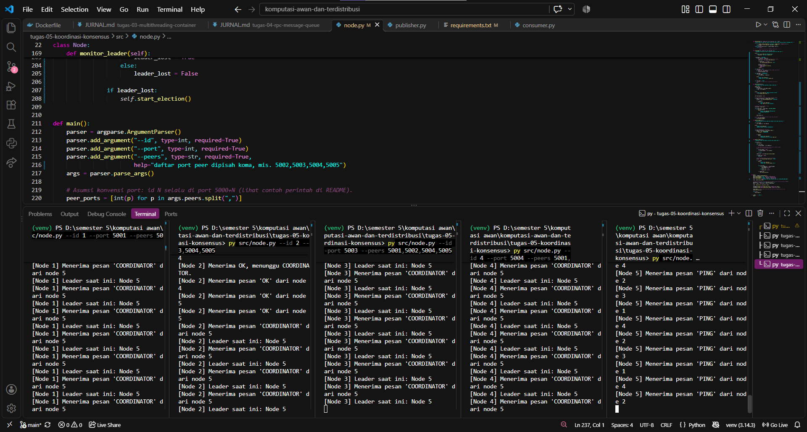
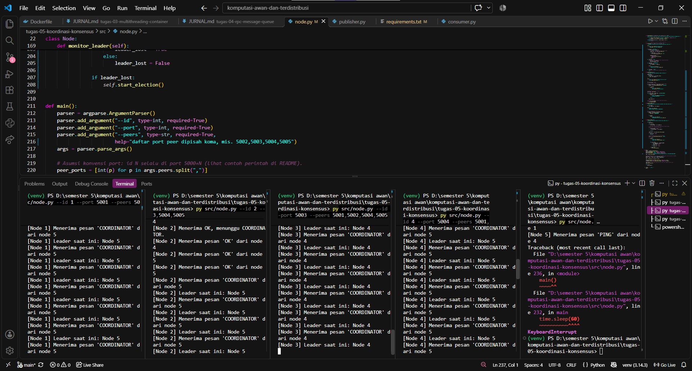

# Jurnal Proses — Tugas 5

## Implementasi Bully
- Kendala saat mengisi TODO 1-4: Kendala yang kami alami saat mengimplementasikan Bully Algorithm adalah kesalahan indentasi dan struktur kode. Beberapa methodnya tidak berada di dalam class dengan benar(ditaruh di luar claass), sehingga program mengalami error `AttributeError` karena method `monitor_leader()` tidak dikenali. Selain itu, terdapat atribut pendukung yang belum didefinisikan dengan benar karna kami lumayan kesulitan dalam mengerjakannya. Kendala tersebut kami atasi dengan memperbaiki indentasi, struktur class, dan kelengkapan atribut yang digunakan dalam proses election.

- Kenapa bully algoritma milih id node tertinggi : Karena pada metode ini ID digunakan sebagai prioritas, Node aktif dengan ID tertinggi dipilih jadi leader karna tidak ada node lain yang aktif dan memiliki prioritas yang lebih tinggi
- Kelemahan : Jumlah pesan waktu election bisa banyak. Selain itu saat leader mati diperlukan beberapa saat(tidak lama) untuk mengecek kegagalan lalu baru memilih leader baru

## Skenario 1: Start normal
- Leader yang terpilih: node 5
- Log/observasi: Kami menjalankan lima node di terminal berbeda dan setiap node saling mengirim pesan untuk pemilihan leader. Dari hasil pengujian, node 5 terpilih sebagai leader karena memiliki ID paling tinggi. Untuk node lainnya menerima pesan COORDINATOR dan mencatat kalau node 5 adalah leader saat ini. Jadi, node 5 terpilih karena konsep dari bully algorithm sendiri yaitu node aktif dengan ID tertinggi akan menjadi leader.

## Skenario 2: Leader dimatikan
- Leader baru yang terpilih: node 4
- Berapa lama waktu sampai leader baru terdeteksi: 
- Log/observasi: Sebelumnya node lain bisa mengirimkan pesan PING untuk memeriksa apakah node 5 masih aktif. Setelah node 5 dimatikan, koneksi ke node gagal dan node lain mendeteksi bahwa leader tidak bisa dihubungi. Oleh karena itu, proses pemilihan leader dilakukan lagi. Node 4 yang memiliki ID tertinggi diantara node yang masih aktif kemudian mengirimkan pesan COORDINATOR kepada node lain untuk memberi tahu kalau dirnya adalah leader baru. Di terminal node 3, terlihat kalau node 4 tercatat sebagai leader baru.

## Log Penggunaan AI (Level 2)

> Wajib diisi sesuai kebijakan Level 2 di [`../RUBRIK-UMUM.md`](../RUBRIK-UMUM.md). Tulis "Tidak memakai AI" pada baris pertama jika memang tidak dipakai. Hanya untuk brainstorming ide/outline — bukan untuk kode/analisis/teks akhir.

| Tanggal | Tool AI | Prompt yang diberikan | Ringkasan saran/ide AI | Bagaimana diolah jadi tulisan/kode sendiri |
|---|---|---|---|---|
| 19-10-2026 | ChatGpt | Apa penyebab error AttributeError pada kode tersebut? | AI menyarankan pemeriksaan keberadaan method monitor_leader dan struktur class Node. | kami mengecek struktur kode dan kesesuaian nama serta posisi method dengan pemanggilannya. |
| 19-10-2026 | ChatGpt | Bagaimana caranya untuk memilih leader pada Bully Algorithm ketika salah satu node mendeteksi leader tidak aktif? | AI memberikan gambaran alur election, yaitu node menghubungi node dengan ID lebih tinggi, menunggu balasan, dan menentukan leader jika tidak ada node dengan ID lebih tinggi yang merespons. | kami menyusun pemahaman alur election sebagai acuan untuk mempelajari proses pemilihan leader pada simulasi. |