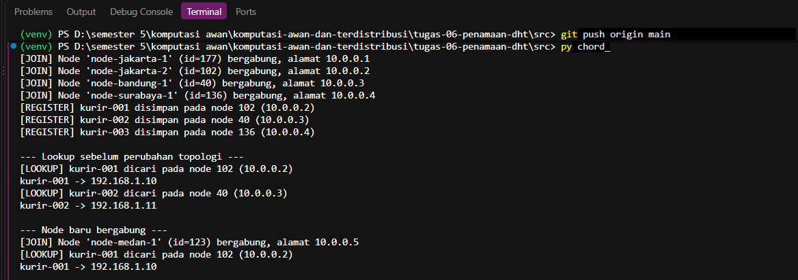
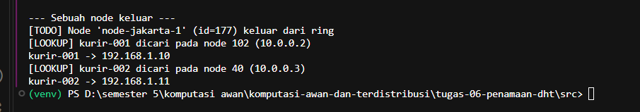
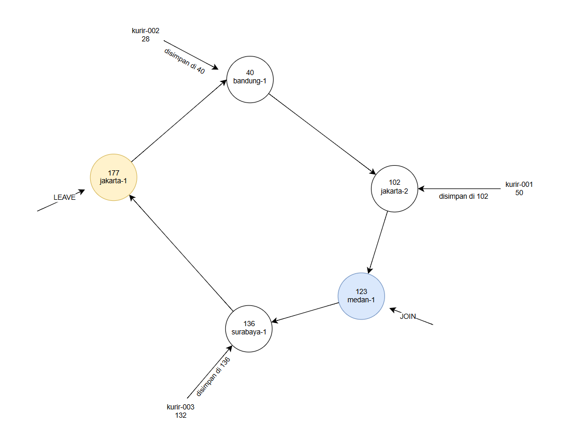

# Jurnal Proses — Tugas 6

## Implementasi find_successor
- Kesalahan pertama yang ditemui (mis. lupa wrap-around di ring): -
- Cara memperbaikinya: -

## Skenario join/leave
- Hasil sebelum & sesudah node baru bergabung: Sebelum node baru bergabung, ada empat node yaitu node-jakarta-1, node-jakarta-2, node-bandung-1, dan node-surabaya-1. Lalu node-medan-1 ID 123 alamat 10.0.0.5 berhasil bergabung ke ring. Pada gambar terlihat bahwa lookup kurir-001 tetap menghasilkan alamat ip 192.168.1.10.

- Hasil sebelum & sesudah node keluar: node-jakarta-1 keluar dari ring lalu setelah node dihapus program lookup kembali pada kurir-001 dan kurir-002 yang hasilnya adalah kurir-001 tetap mempunyai alamat ip 192.168.1.10 sedangkan kurir-002 tetap mempunyai alamat ip 192.168.1.11.

## Tugas Analisis
1. DHT/Chord lebih cocok karena IP kurir sering berubah jadi pemetaan ID kurir ke IP dapat diperbarui dengan flesibel. Berbeda dengan tabel pusat yang bergantung pada satu server, chord menyimpan data secara terdistribusi pada beberpa node.Chord juga lebih mudah untuk menyesuaikan perubahan node melalui join dan leave, jadi tanggung jawab penyimpanan data dapat dialihkan ke node lain tanpa bergantu pada satu server pusat.

2. 

3. setelah node-jakarta-1 keluar, node-bandung-1 jadi successor berikutnya karena pencarian kembali ke awal ring. Dari output, kurir-001 dan kurir-002 masih berhasil ditemukan dengan alamat ip masing-masing yang menunjukkan bahwa lookup tetap berjalan meskipun ada node yang keluar dari ring.

## Log Penggunaan AI (Level 2)

> Wajib diisi sesuai kebijakan Level 2 di [`../RUBRIK-UMUM.md`](../RUBRIK-UMUM.md). Tulis "Tidak memakai AI" pada baris pertama jika memang tidak dipakai. Hanya untuk brainstorming ide/outline — bukan untuk kode/analisis/teks akhir.

| Tanggal | Tool AI | Prompt yang diberikan | Ringkasan saran/ide AI | Bagaimana diolah jadi tulisan/kode sendiri |
|---|---|---|---|---|
| 03/11/2026 | ChatGPT | Jelaskan konsep DHT dan algoritma chord dalam komputasi awan | AI menjelaskan konsep hashing, ring, node, dan successor. | penjelasana tersebut digunakan untuk memahami konsep DHT agar bisa mengimplementasikan program |
