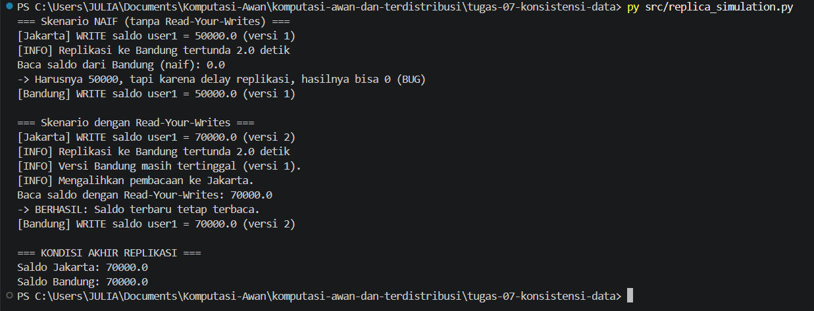

# Jurnal Proses — Tugas 7

## Diskusi pemilihan model konsistensi
- Argumen yang dipertimbangkan: Di studi kasus data saldo pelanggan disimpan di dua server (Jakarta dan Bandung) lalu saat pelanggan top up melalui server Jakarta, perubahan saldo tidak segera diterima server Bandung karena keterlambatan proses replikasi. Pada kasus lain seperti jumlah like di media sosial, apabila ada perbedaan jumlah like tidak begitu pengaruh. Beda dengan kasus data saldo pelanggan yang apabila ada perbedaan maka berdampak besar pada transaksi dan dapat merugikan pelanggan.
- Kesimpulan akhir & alasan: Kami memilih eventual consistency dengan tambahan client-centric consistency dengan mekanisme read-your-writes. Menurut kami eventual consistency saja sudah cukup dan tidak memilih sequential consistency karena proses transaksi berpotensi menjadi lebih lambat karena harus menunggu atau berkoordinasi dengan server lain, jadi menggunakan eventual consistency karena replikasi bisa tetap berjalan asynchronous (proses replikasi berjalan secara bertahap sehingga data pada server Jakarta dan Bandung dapat berbeda sementara, tetapi akan menjadi sama setelah proses replikasi selesai). Client-centric consistency dengan mekanisme read-your-writes digunakan untuk memastikan pelanggan dapat melihat perubahan data terbaru yang dilakukan pelanggan, jadi apabila server Bandung belum menerima pembaruan saldo sistem mengarahkan permintaan pembacaan ke server Jakarta yang sudah punya data terbarunya. Pelanggan tetap dapat melihat saldo yang benar meskipun proses replikasinya masih belum selesai.

## Simulasi (jika dikerjakan)
- Hasil skenario naif vs Read-Your-Writes: Pada skenario naif, pelanggan top up sebesar 50000 melalui server Jakarta. Saldo di server Jakarta berubah menjadi 50000 sedangkan server Bandung belum menerima pembaruan karena proses replikasi masih berlangsung. Jadi pelanggan mencoba membaca saldo melalui server Bandung, saldo yang ditampilkan masih 0. Pada skenario dengan read-your-writes pelanggan kembali melakukan top up sebesar 20000, karena sebelumnya sudah memiliki saldo 50000 maka saldo terbaru di server Jakarta menjadi 70000. Jadi saat pelanggan mencoba membaca saldo dari server Bandung, program mengecek data yang dimiliki, karena server Bandung data nya masih tertinggal sistem mengalihkan proses pembacaan ke server Jakarta dan hasilnya saldo terbaru pelanggan 70000 meskipun proses replikasi ke Bandung belum selesai.

## Log Penggunaan AI (Level 2)

> Wajib diisi sesuai kebijakan Level 2 di [`../RUBRIK-UMUM.md`](../RUBRIK-UMUM.md). Tulis "Tidak memakai AI" pada baris pertama jika memang tidak dipakai. Hanya untuk brainstorming ide/outline — bukan untuk kode/analisis/teks akhir.

| Tanggal | Tool AI | Prompt yang diberikan | Ringkasan saran/ide AI | Bagaimana diolah jadi tulisan/kode sendiri |
|---|---|---|---|---|
| ... | ... | ... | ... | ... |
